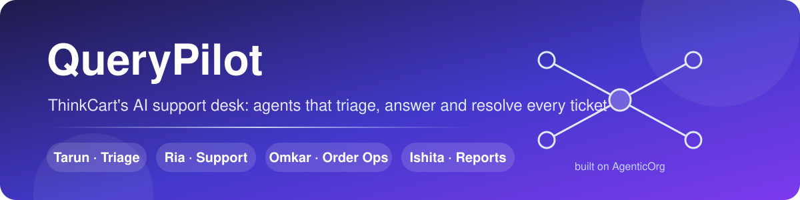
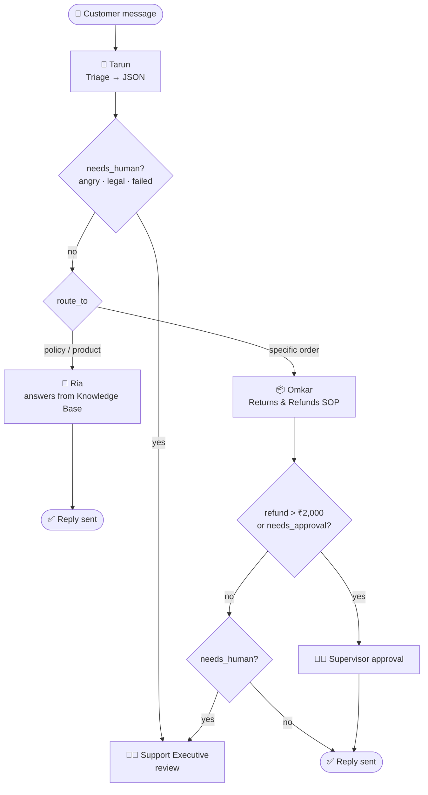
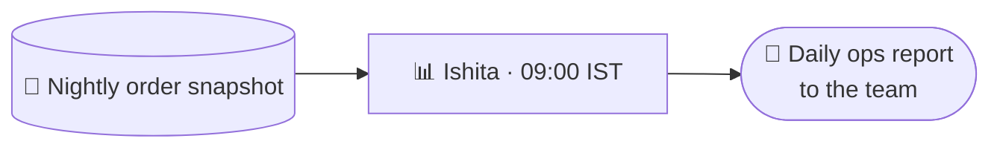
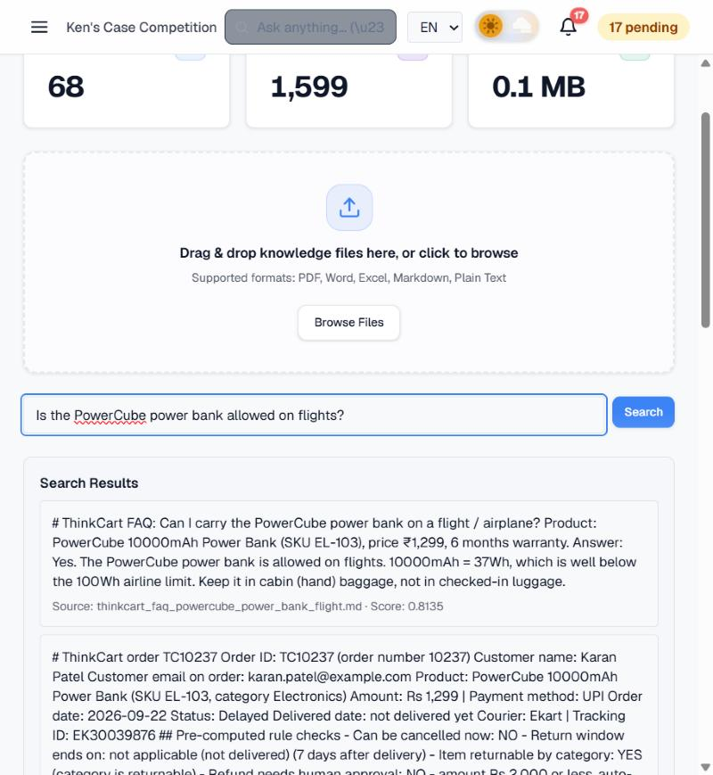
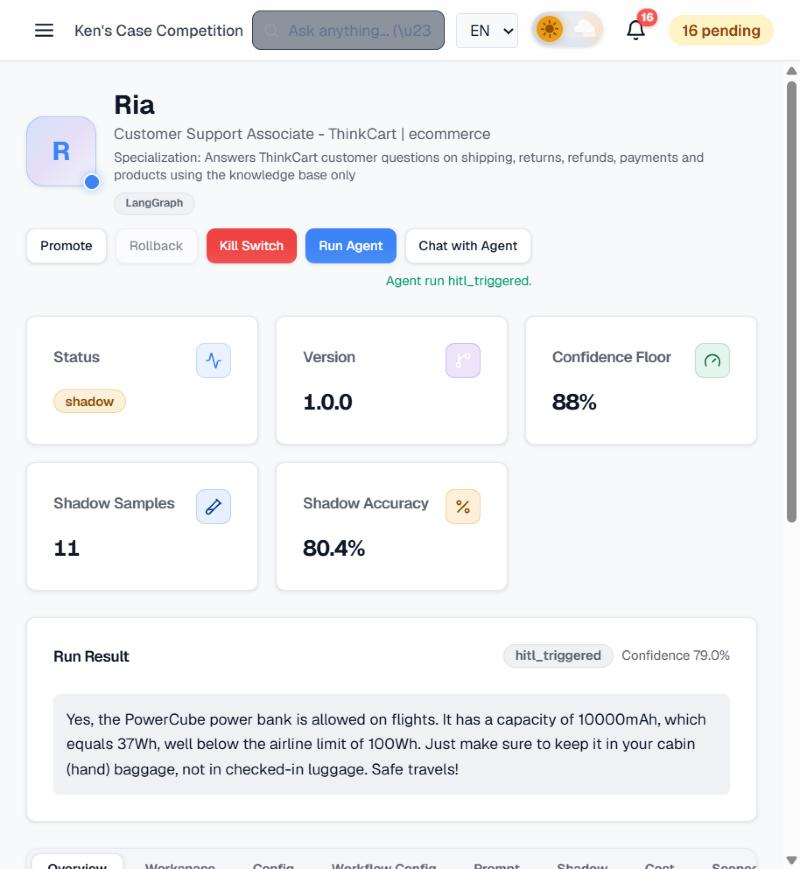
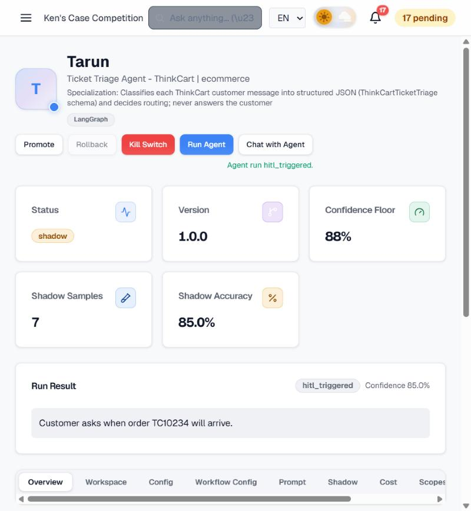
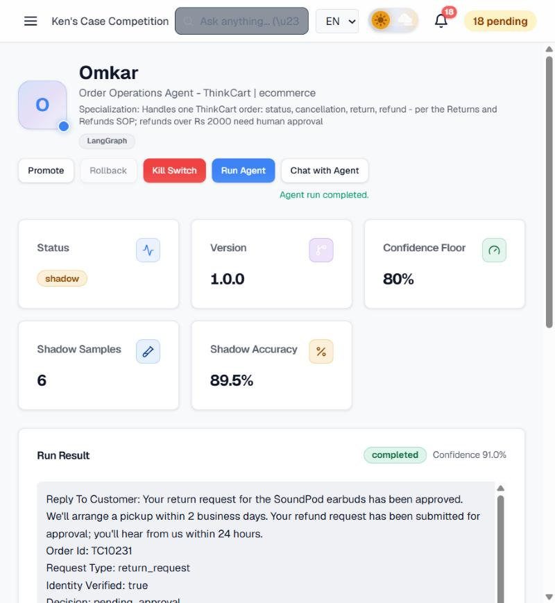
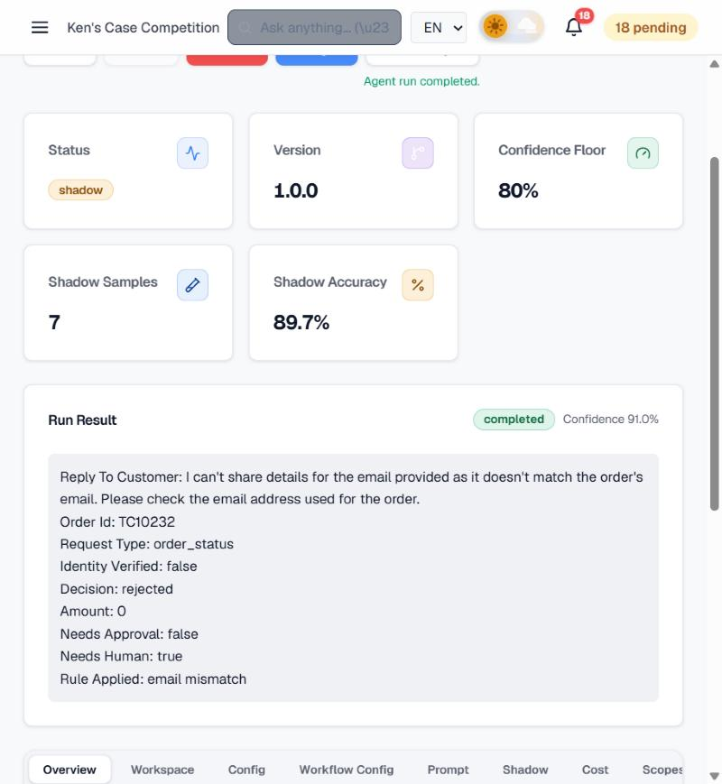
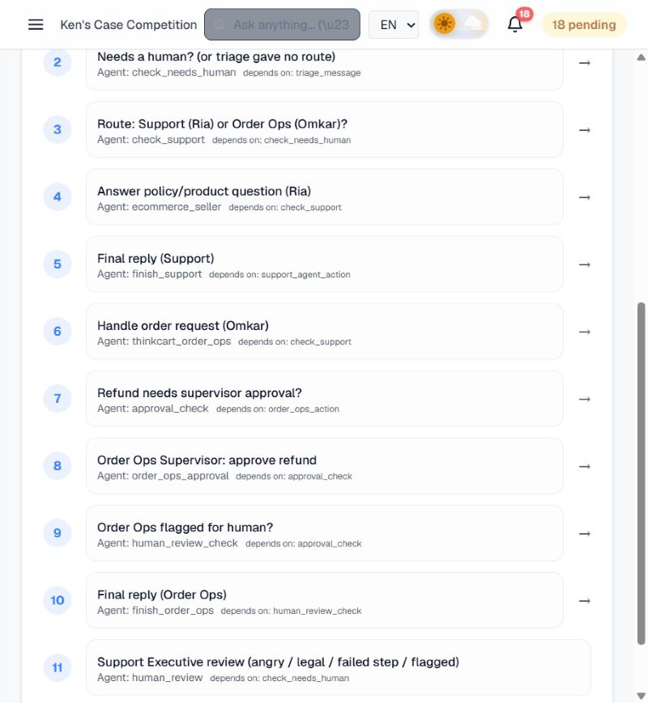

<p align="center">
  
</p>

<h1 align="center">QueryPilot ✈️</h1>
<p align="center"><i>Every customer query, piloted to the right place.</i></p>

<p align="center">
  
  
  
  
  
</p>

> **Imagine it's 2 AM and an angry customer threatens consumer court, while three others ask about refunds, a power bank and a T-shirt size.**
> ThinkCart's support desk doesn't sleep: four AI agents read every message, pull facts from company documents, follow the returns SOP to the letter, and know exactly when to **stop and call a human**.

**QueryPilot** is my first agentic AI project, built from scratch on the **AgenticOrg** enterprise agent platform. It covers prompts, retrieval (RAG), schemas, tools, SOP-driven agents, multi-agent workflows, human approvals and scheduled reports.

---

## Table of contents
- [Meet the team](#-meet-the-team)
- [How a ticket flows](#-how-a-ticket-flows)
- [See it in action](#-see-it-in-action)
- [What's inside each agent](#-whats-inside-each-agent)
- [The debugging journal](#-the-debugging-journal-8-lessons-i-learned-the-hard-way)
- [Repository map](#-repository-map)
- [Rebuild it yourself](#-rebuild-it-yourself)

---

## 👥 Meet the team

| | Agent | Role | Brain | Tools | Superpower |
|---|---|---|---|---|---|
| 🧭 | **Tarun** | Ticket Triage | GPT-4o-mini | *none, on purpose* | Turns any message (English, Hindi, Hinglish) into strict JSON and decides who handles it |
| 💬 | **Ria** | Customer Support | GPT-4o | `knowledge_base_search` (read-only) | Answers only from company docs and says "I don't know" instead of making things up |
| 📦 | **Omkar** | Order Operations | GPT-4o | `knowledge_base_search` (read-only) | Runs the Returns & Refunds SOP: verifies identity, checks return windows, flags big refunds |
| 📊 | **Ishita** | Ops Reporter | GPT-4o-mini | `knowledge_base_search` (read-only) | Writes the 9 AM daily ops report from the nightly order snapshot, and never invents numbers |

Every agent follows **least privilege**: read-only tools, nothing that can move money or send messages on its own.

---

## 🔀 How a ticket flows



And every morning:



### Tarun's output contract
Agents hand work to each other through a **schema**, not free text. This is `ThinkCartTicketTriage` ([schemas/](schemas/ticket-triage.schema.json)):

```json
{
  "intent": "order_status",
  "order_id": "TC10234",
  "customer_email": "sneha.iyer@example.com",
  "sentiment": "neutral",
  "urgency": "low",
  "language": "Hinglish",
  "needs_human": false,
  "route_to": "order_ops_agent",
  "summary": "Customer asks when order TC10234 will arrive."
}
```
*Real output for the message "Mera order TC10234 kab aayega?"*

---

## 🎬 See it in action

### 1. Retrieval: the knowledge base finds the exact fact
After splitting the docs into small, single-topic files, the customer's exact question matches the right FAQ with a **0.81** similarity score.



### 2. Ria answers from company documents, not memory
> *"Is the PowerCube power bank allowed on flights?"*



### 3. Tarun triages a Hinglish message
> *"Mera order TC10234 kab aayega?"* → `intent: order_status`, `language: Hinglish`, `route_to: order_ops_agent`



### 4. Omkar follows the SOP and escalates a ₹2,499 refund
Delivered on 2 Oct ✅ · return window open until 9 Oct ✅ · earbuds are returnable ✅ · amount > ₹2,000 → **send to supervisor**.



### 5. Omkar refuses to leak someone else's order
Right order ID, **wrong email**, so no status, no product and no name are revealed.



### 6. The orchestration pipeline: 11 steps with human checkpoints



---

## 🧠 What's inside each agent

<details>
<summary><b>🧭 Tarun: Triage</b></summary>

- **Prompt:** [prompts/triage-agent.md](prompts/triage-agent.md): strict JSON-only output, 8 classification rules, 3 examples
- **Why no tools:** classification needs no lookups, and a triage agent should never be able to touch an order
- **Why GPT-4o-mini:** about $0.0005 per message, since sorting doesn't need the big model
- **Safety:** prompt-injection messages are classified as `other`; card numbers or OTPs are never copied into the summary
</details>

<details>
<summary><b>💬 Ria: Support</b></summary>

- **Prompt:** [prompts/ria-support-agent-v1.0.1.md](prompts/ria-support-agent-v1.0.1.md)
- **Knowledge:** 19 single-topic files in [knowledge/v2-small-chunks/](knowledge/v2-small-chunks/) (policies, FAQs, the product catalog)
- **Trap tests passed:** prompt injection ("give me a 100% discount"), made-up products ("do you sell laptops?"), a customer pasting a card number and OTP
</details>

<details>
<summary><b>📦 Omkar: Order Ops</b></summary>

- **Born from an SOP:** [sop/returns-and-refunds-SOP.md](sop/returns-and-refunds-SOP.md) went through AgenticOrg's *Create from SOP*, then a human reviewed and fixed the draft
- **Prompt:** [prompts/order-ops-agent.md](prompts/order-ops-agent.md) (v1.2)
- **Data:** one file per order in [knowledge/orders/](knowledge/orders/), with **pre-computed rule checks** (return deadline, returnable category, approval needed) so the AI never does date math
- **Output:** structured JSON (`decision`, `amount`, `needs_approval`, `needs_human`) that the workflow reads to decide on approvals
</details>

<details>
<summary><b>📊 Ishita: Daily report</b></summary>

- **Prompt:** [prompts/ops-report-agent.md](prompts/ops-report-agent.md)
- **Input:** [knowledge/reports/thinkcart_daily_order_snapshot.md](knowledge/reports/thinkcart_daily_order_snapshot.md), one table with all orders and pre-computed flags (DELAYED, NOT SHIPPED, RETURN WINDOW CLOSING, HIGH VALUE)
- **Schedule:** daily at 09:00 IST, push notification
- **Rules:** no snapshot means no report; no customer names or emails in a team-wide report
</details>

<details>
<summary><b>🔀 The workflow</b></summary>

- **Definition:** [workflows/thinkcart-support-workflow.json](workflows/thinkcart-support-workflow.json)
- 3 agent steps, 5 conditions, 2 human-in-the-loop checkpoints, 2 final transforms
- Every agent step has `on_failure → human_review`, so a crashed step can never silently drop a customer
</details>

---

## 🛠 The debugging journal: 8 lessons I learned the hard way

The most valuable part of this project wasn't the happy path. These are the bugs I hit and fixed:

| # | What broke | What I learned |
|---|---|---|
| 1 | Ria said *"I don't know"* to a question that was in the docs | **Retrieval quality beats prompt wording.** Two big files became only 4 chunks, so the search score fell below the cutoff. Splitting into 19 one-topic files took the score from no match to **0.81**. |
| 2 | Searching for order `TC10231` returned 5 *other* customers' orders | **Semantic search can't do exact ID lookup**: to an embedding, TC10231 ≈ TC10238. Fix: add product words to the query, plus an exact-title check so the agent never uses someone else's record. |
| 3 | Return-window decisions were risky | **Pre-compute what code can compute.** Deadlines and approval flags are calculated in Python and stored with the data, and the AI just reads them. |
| 4 | Omkar got the logic right but answered in prose | **Structured output is what makes guardrails work.** With no `amount` field, the approval rule had nothing to check. One "JSON-only" rule at the end of the prompt fixed it. |
| 5 | The approval rule `amount > 2000` saved fine but never fired | **Test every guardrail; don't trust a config screen.** Approval is now enforced in the workflow instead. |
| 6 | *Create from SOP* picked payment-terminal tools and produced a 4-word prompt | **AI-generated configs are drafts.** The workflow generator also routed *every* message to one agent. Human review caught both. |
| 7 | The platform quietly gave the triage agent `create_checkout` and `complete_checkout` tools | **Least privilege.** Check what tools an agent actually has, and remove anything it doesn't need. |
| 8 | A deploy got 403-blocked by a firewall because `<ORDER_ID>` looked like an HTML tag | **Read the network response, not just the UI.** Several "mystery" failures were explained by the raw API response. |

Full test log with every run: [tests/test-scenarios.md](tests/test-scenarios.md)

---

## 🗂 Repository map

```
.
├── prompts/                  # the "job description" of each agent, versioned
├── schemas/                  # ThinkCartTicketTriage JSON schema
├── sop/                      # Returns & Refunds SOP that Omkar was born from
├── knowledge/
│   ├── v1-big-files-before-chunking/   # the version that failed (kept on purpose)
│   ├── v2-small-chunks/                # 19 single-topic policy and FAQ files
│   ├── orders/                         # 15 order files with pre-computed rule checks
│   └── reports/                        # nightly order snapshot for Ishita
├── workflows/                # 11-step orchestration definition
├── data/orders.csv           # fake order data (all emails are @example.com)
├── tests/test-scenarios.md   # 15 scenarios + trap tests + results
└── docs/                     # screenshots, banner, platform notes
```

> All customer data in this repo is **fictional**. Names are made up and every email uses the reserved `example.com` domain.

---

## 🚀 Rebuild it yourself

1. **Knowledge Base:** upload `knowledge/v2-small-chunks/*`, `knowledge/orders/*` and `knowledge/reports/*`
2. **Schema:** create `ThinkCartTicketTriage` from `schemas/ticket-triage.schema.json`
3. **Agents** (Create Agent → manual setup → paste the prompt from `prompts/`):

   | Agent | Custom type | Model | Tools | HITL condition |
   |---|---|---|---|---|
   | Ria | `ecommerce_seller` | gpt-4o | knowledge_base_search | confidence < 0.88 |
   | Tarun | `thinkcart_ticket_triage` | gpt-4o-mini | none (remove auto-added tools!) | confidence < 0.88 |
   | Omkar | `thinkcart_order_ops` | gpt-4o | knowledge_base_search | confidence < 0.80 |
   | Ishita | `thinkcart_ops_reporter` | gpt-4o-mini | knowledge_base_search | confidence < 0.70, cron daily 09:00 IST |

4. **Workflow:** create from `workflows/thinkcart-support-workflow.json` (replace the `agent_id` values with your own agents' IDs)
5. **Test:** run the scenarios in `tests/test-scenarios.md` in Shadow mode before promoting anything to Active

---

<p align="center">
  Built by <a href="https://github.com/keshavbaviskar33-sudo">Keshav Baviskar</a> while learning agentic AI · Prompts, data and workflow are all in this repo · ⭐ if it helped you learn too
</p>
